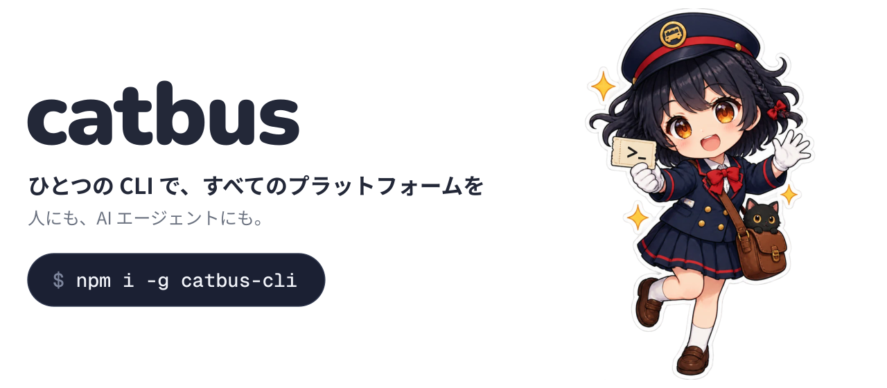
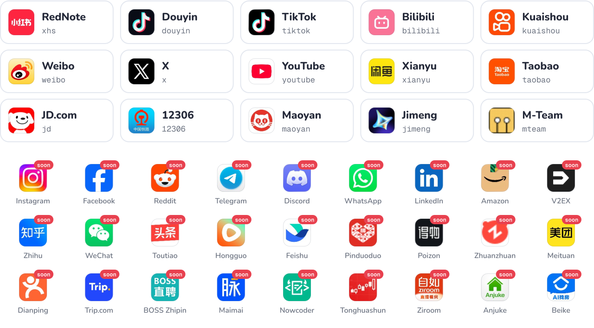

<a href="docs/guide/quick-start.md">
  <picture>
    <source media="(prefers-color-scheme: dark)" srcset="assets/hero-ja-dark.svg">
    
  </picture>
</a>

<div align="center">

[](https://github.com/cv-cat/catbus/stargazers)
[](LICENSE)
[](package.json)

[English](README.md) · [简体中文](README.zh-CN.md) · **日本語** · [한국어](README.ko.md)

</div>

catbus は、ひとつのコマンド体系ですべてのプラットフォームを操作できるオープンソースの CLI です。RedNote、Douyin、TikTok、Bilibili、X、YouTube などで、検索、取得、ダウンロード、投稿、メッセージ送信を同じコマンドで行い、結果はいつも同じ JSON で返ります。自分で使うことも、AI エージェントに任せることもできます。

<div align="center">

<a href="https://api.openai-next.com">
  <picture>
    <source media="(prefers-color-scheme: dark)" srcset="assets/sponsors/vectrust-dark.png">
    
  </picture>
</a>

<sub>スポンサー：[Vectrust](https://api.openai-next.com) @ OpenDev Org & NextRouter Alliance · [ここに掲載しませんか？](mailto:992822653@qq.com)</sub>

</div>

## クイックスタート

```bash
npm i -g catbus-cli         # 必要なのは Node だけ

catbus bilibili auth login  # QR コードでログイン
catbus bilibili item search cat --limit 20
catbus tui           # コマンドを覚えたくない？全画面 UI を使う
```

Docker やソースからのインストールは[クイックスタートガイド](docs/guide/quick-start.md)、全画面 UI は[ターミナル UI](docs/guide/tui.md)をご覧ください。

## ひとつのコマンド体系で、すべてのプラットフォームを

コマンドはすべて `catbus <platform> <resource> <action>` の 3 つの部分でできています。RedNote の投稿、Bilibili の動画、X のツイート、Taobao の商品はどれも `item` と呼ぶので、同じコマンドがどこでも使えます。プラットフォームを変えるときは、プラットフォーム名だけを書き換えます。

```bash
catbus xhs item search camping --limit 20             # 検索
catbus bilibili item get BV1xx411c7mD                 # 詳細を取得
catbus douyin comment list <item> --all -o jsonl      # コメントをすべて書き出す
catbus youtube item download <item> --dir ./videos    # ダウンロード
catbus x item publish --text "hello" --image cat.png  # 投稿
catbus bilibili live listen <room> --duration 10m     # ライブのコメントを受信
catbus taobao msg send "hi" --item <url>              # 出品者に連絡
catbus 12306 ticket search beijing shanghai           # 列車の空席を検索
```

どのコマンドも同じ形の JSON を返します（ここでは一部を省略）：

```json
{
  "ok": true,
  "platform": "bilibili",
  "resource": "item",
  "action": "search",
  "data": [
    {
      "id": "BV1xx411c7mD",
      "kind": "video",
      "url": "https://www.bilibili.com/video/BV1xx411c7mD",
      "title": "…",
      "author": { "id": "…", "name": "…", "url": "…" },
      "stats": { "views": 12000, "likes": 340, "comments": 56, "collects": 78, "shares": 9 }
    }
  ],
  "page": { "cursor": "…", "has_more": true },
  "error": null
}
```

## プラットフォーム

<picture>
  <source media="(prefers-color-scheme: dark)" srcset="assets/platforms-dark.svg">
  
</picture>

`soon` が付いているものは準備中です。目標はすべてのプラットフォーム。足りなければ [issue を立てる](https://github.com/cv-cat/catbus/issues)か、[自分で追加](.github/CONTRIBUTING.md)してください。1 プラットフォームは 1 ディレクトリです。各プラットフォームの対応状況は[機能一覧](docs/capabilities.md)にあります。

## なぜ catbus か

- **ブラウザも Python も不要。** catbus はページと同じ方法で署名し、素の HTTP で通信します。必要なのは Node だけで、Windows、macOS、Linux で動きます。例外は 2 つ：[YouTube への投稿](docs/platforms/youtube.md)にはローカルの Chromium が必要で、[Jimeng](docs/platforms/jimeng.md) は公式 CLI をラップしており macOS のみ対応です。
- **エージェント向け。** stdout は JSON のみ、ログは stderr、終了コードは安定、エラーには次に実行すべきコマンドが入ります。
- **ログイン情報はあなたのもの。** `~/.catbus/` にプラットフォームとアカウントごとに保存します。テレメトリはありません。

## AI エージェント向け

_ の切符を掲げる catbus の車掌さん" width="150" align="right">

```bash
npx skills add cv-cat/catbus
```

catbus スキルを Claude Code、Cursor、Codex などに入れられます。[llms.txt](llms.txt) と [AGENTS.md](AGENTS.md) もどうぞ。

あとはこう頼むだけ：

> 今週 RedNote でいいねが多かったキャンプの投稿を 20 件探して、よく挙がっている道具をまとめて。

<br clear="right">

## ドキュメント

[クイックスタート](docs/guide/quick-start.md) · [ログイン](docs/guide/login.md) · [出力とエラー](docs/guide/output.md) · [設定](docs/guide/configuration.md) · [Docker](docs/guide/docker.md) · [プラットフォーム別ガイド](docs/platforms/README.md) · [サンプル](docs/examples/README.md) · [FAQ](docs/guide/faq.md)

ガイドは中国語で書かれています。コマンド名、オプション、JSON のフィールドは英語です。

## コントリビュート


新しいプラットフォーム、コマンド、修正を歓迎します。先に [CONTRIBUTING.md](.github/CONTRIBUTING.md) と [AGENTS.md](AGENTS.md) をお読みください。セキュリティ報告は [SECURITY.md](.github/SECURITY.md) へ。

<br clear="right">

## Star 履歴

<a href="https://cvcat.site/star-history/svg?repos=cv-cat/catbus&type=Date">
  <picture>
    <source media="(prefers-color-scheme: dark)" srcset="https://cvcat.site/star-history/svg?repos=cv-cat/catbus&type=Date&theme=dark" />
    <source media="(prefers-color-scheme: light)" srcset="https://cvcat.site/star-history/svg?repos=cv-cat/catbus&type=Date" />
    
  </picture>
</a>

<details>
<summary>免責事項</summary>

<br>

- 本プロジェクトは学習・研究目的のみです。商用や違法な目的では使用しないでください。
- 各プラットフォームの利用規約とお住まいの地域の法令を守ってください。他人の個人情報を収集・拡散せず、プラットフォームに過度な負荷をかけないでください。
- 自動化はリスク管理に引っかかる場合があります（CAPTCHA、レート制限、アカウント停止など）。結果の責任はすべて利用者が負います。
- 本プロジェクトは記載されたいずれのプラットフォームとも無関係で、承認も受けていません。名称、アイコン、商標は各所有者に帰属します。

</details>

## ライセンス

[MIT](LICENSE) © 2026 [cv-cat](https://github.com/cv-cat)。プラットフォーム名とロゴは各所有者に帰属します（[出典](scripts/assets/logos/SOURCES.txt)）。
