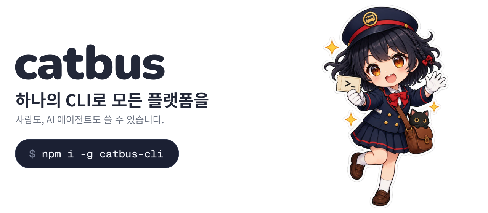
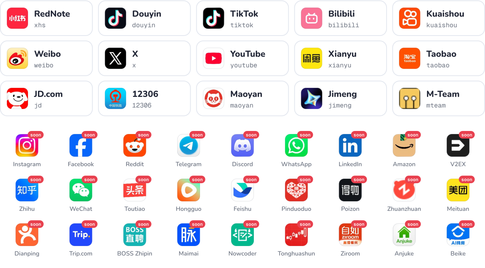

<a href="docs/guide/quick-start.md">
  <picture>
    <source media="(prefers-color-scheme: dark)" srcset="assets/hero-ko-dark.svg">
    
  </picture>
</a>

<div align="center">

[](https://github.com/cv-cat/catbus/stargazers)
[](LICENSE)
[](package.json)

[English](README.md) · [简体中文](README.zh-CN.md) · [日本語](README.ja.md) · **한국어**

</div>

catbus는 하나의 명령 체계로 모든 플랫폼을 다루는 오픈소스 CLI입니다. RedNote, Douyin, TikTok, Bilibili, X, YouTube 등에서 검색, 조회, 다운로드, 게시, 메시지 전송을 같은 명령으로 처리하고, 결과는 언제나 같은 JSON으로 돌아옵니다. 직접 써도 되고, AI 에이전트에게 맡겨도 됩니다.

<div align="center">

<a href="https://api.openai-next.com">
  <picture>
    <source media="(prefers-color-scheme: dark)" srcset="assets/sponsors/vectrust-dark.png">
    
  </picture>
</a>

<sub>후원: [Vectrust](https://api.openai-next.com) @ OpenDev Org & NextRouter Alliance · [여기에 소개되고 싶다면?](mailto:992822653@qq.com)</sub>

</div>

## 빠른 시작

```bash
npm i -g catbus-cli         # Node만 있으면 됩니다

catbus bilibili auth login  # QR 코드로 로그인
catbus bilibili item search cat --limit 20
catbus tui           # 명령을 외우기 싫다면 전체 화면 UI
```

Docker나 소스 설치는 [빠른 시작 가이드](docs/guide/quick-start.md), 전체 화면 UI는 [터미널 UI](docs/guide/tui.md)를 참고하세요.

## 하나의 명령 체계로 모든 플랫폼을

모든 명령은 `catbus <platform> <resource> <action>` 세 부분으로 이루어집니다. RedNote 게시물, Bilibili 영상, X 트윗, Taobao 상품은 모두 `item`이라서 같은 명령을 어디서나 쓸 수 있습니다. 플랫폼을 바꿀 때는 플랫폼 이름만 바꾸면 됩니다.

```bash
catbus xhs item search camping --limit 20             # 검색
catbus bilibili item get BV1xx411c7mD                 # 상세 조회
catbus douyin comment list <item> --all -o jsonl      # 댓글 전체 내보내기
catbus youtube item download <item> --dir ./videos    # 다운로드
catbus x item publish --text "hello" --image cat.png  # 게시
catbus bilibili live listen <room> --duration 10m     # 라이브 채팅 수신
catbus taobao msg send "hi" --item <url>              # 판매자에게 연락
catbus 12306 ticket search beijing shanghai           # 기차표 검색
```

모든 명령은 같은 형태의 JSON을 돌려줍니다(여기서는 일부 생략):

```json
{
  "ok": true,
  "platform": "bilibili",
  "resource": "item",
  "action": "search",
  "data": [
    {
      "id": "BV1xx411c7mD",
      "kind": "video",
      "url": "https://www.bilibili.com/video/BV1xx411c7mD",
      "title": "…",
      "author": { "id": "…", "name": "…", "url": "…" },
      "stats": { "views": 12000, "likes": 340, "comments": 56, "collects": 78, "shares": 9 }
    }
  ],
  "page": { "cursor": "…", "has_more": true },
  "error": null
}
```

## 플랫폼

<picture>
  <source media="(prefers-color-scheme: dark)" srcset="assets/platforms-dark.svg">
  
</picture>

`soon` 표시가 있는 것은 오는 중입니다. 목표는 모든 플랫폼입니다. 찾는 플랫폼이 없다면 [issue를 열거나](https://github.com/cv-cat/catbus/issues) [직접 추가](.github/CONTRIBUTING.md)하세요. 플랫폼 하나는 디렉터리 하나입니다. 플랫폼별 지원 범위는 [기능 표](docs/capabilities.md)에서 볼 수 있습니다.

## 왜 catbus인가

- **브라우저도 Python도 필요 없습니다.** catbus는 페이지와 같은 방식으로 서명하고 평범한 HTTP로 통신합니다. Node만 있으면 Windows, macOS, Linux에서 동작합니다. 예외는 두 가지입니다. [YouTube 게시](docs/platforms/youtube.md)에는 로컬 Chromium이 필요하고, [Jimeng](docs/platforms/jimeng.md)은 공식 CLI를 감싸며 macOS만 지원합니다.
- **에이전트를 위해.** stdout은 JSON뿐이고, 로그는 stderr로 나가며, 종료 코드는 안정적이고, 오류에는 다음에 실행할 명령이 담깁니다.
- **로그인 정보는 당신의 것.** `~/.catbus/`에 플랫폼과 계정별로 저장되며 텔레메트리는 없습니다.

## AI 에이전트용

_ 승차권을 들고 종이비행기를 탄 catbus 차장" width="150" align="right">

```bash
npx skills add cv-cat/catbus
```

catbus 스킬을 Claude Code, Cursor, Codex 등에 설치할 수 있습니다. [llms.txt](llms.txt)와 [AGENTS.md](AGENTS.md)도 참고하세요.

그다음엔 이렇게 말하면 됩니다:

> 이번 주 RedNote에서 좋아요가 가장 많은 캠핑 게시물 20개를 찾아서, 가장 많이 언급된 장비를 정리해 줘.

<br clear="right">

## 문서

[빠른 시작](docs/guide/quick-start.md) · [로그인](docs/guide/login.md) · [출력과 오류](docs/guide/output.md) · [설정](docs/guide/configuration.md) · [Docker](docs/guide/docker.md) · [플랫폼별 안내](docs/platforms/README.md) · [예제](docs/examples/README.md) · [FAQ](docs/guide/faq.md)

가이드는 중국어로 작성되어 있습니다. 명령 이름, 옵션, JSON 필드는 영어입니다.

## 기여


새 플랫폼, 새 명령, 수정을 환영합니다. 먼저 [CONTRIBUTING.md](.github/CONTRIBUTING.md)와 [AGENTS.md](AGENTS.md)를 읽어 주세요. 보안 문제는 [SECURITY.md](.github/SECURITY.md)를 참고하세요.

<br clear="right">

## Star 추이

<a href="https://cvcat.site/star-history/svg?repos=cv-cat/catbus&type=Date">
  <picture>
    <source media="(prefers-color-scheme: dark)" srcset="https://cvcat.site/star-history/svg?repos=cv-cat/catbus&type=Date&theme=dark" />
    <source media="(prefers-color-scheme: light)" srcset="https://cvcat.site/star-history/svg?repos=cv-cat/catbus&type=Date" />
    
  </picture>
</a>

<details>
<summary>면책 조항</summary>

<br>

- 이 프로젝트는 학습과 연구 목적으로만 사용하세요. 상업적 또는 불법적 용도로 사용하지 마세요.
- 각 플랫폼의 이용 약관과 거주 지역의 법률을 따르세요. 타인의 개인정보를 수집하거나 유포하지 말고, 플랫폼에 과도한 부하를 주지 마세요.
- 자동화는 위험 관리 시스템을 작동시킬 수 있습니다(CAPTCHA, 속도 제한, 계정 정지 등). 모든 결과에 대한 책임은 사용자에게 있습니다.
- 이 프로젝트는 언급된 어떤 플랫폼과도 무관하며, 승인을 받지 않았습니다. 이름, 아이콘, 상표는 각 소유자에게 있습니다.

</details>

## 라이선스

[MIT](LICENSE) © 2026 [cv-cat](https://github.com/cv-cat). 플랫폼 이름과 로고는 각 소유자에게 있습니다([출처](scripts/assets/logos/SOURCES.txt)).
