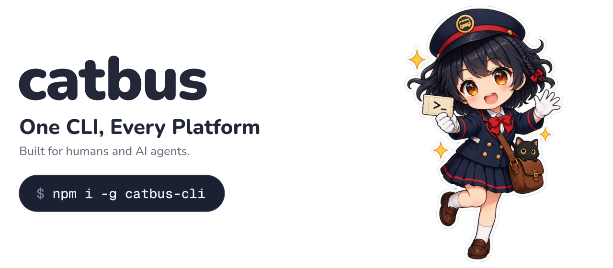
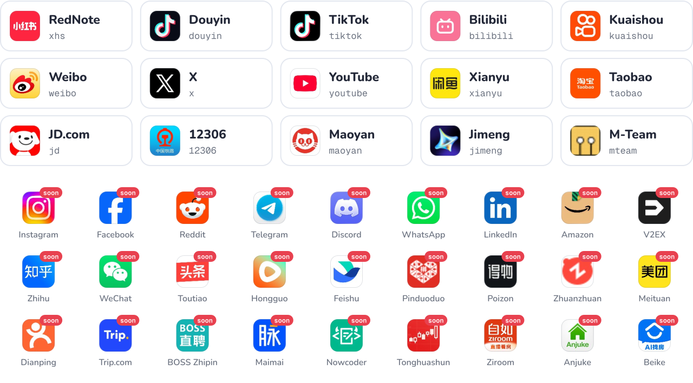

<a href="docs/guide/quick-start.md">
  <picture>
    <source media="(prefers-color-scheme: dark)" srcset="assets/hero-en-dark.svg">
    
  </picture>
</a>

<div align="center">

[](https://github.com/cv-cat/catbus/stargazers)
[](LICENSE)
[](package.json)

**English** · [简体中文](README.zh-CN.md) · [日本語](README.ja.md) · [한국어](README.ko.md)

</div>

catbus is an open-source CLI that drives every platform with one set of commands: RedNote, Douyin, TikTok, Bilibili, X, YouTube and more. Search, read, download, publish and message, and get the same JSON back every time. Use it yourself, or hand it to an AI agent.

<div align="center">

<a href="https://api.openai-next.com">
  <picture>
    <source media="(prefers-color-scheme: dark)" srcset="assets/sponsors/vectrust-dark.png">
    
  </picture>
</a>

<sub>Sponsored by [Vectrust](https://api.openai-next.com) @ OpenDev Org & NextRouter Alliance · [Want to appear here?](mailto:992822653@qq.com)</sub>

</div>

## Quick start

```bash
npm i -g catbus-cli         # only Node needed

catbus bilibili auth login  # scan a QR code
catbus bilibili item search cat --limit 20
catbus tui    # don't want to memorize commands? use the full-screen UI
```

Prefer Docker or a source install? See the [quick start guide](docs/guide/quick-start.md). The full-screen interface is described in [Terminal UI](docs/guide/tui.md).

## One set of commands for every platform

Every command has three parts: `catbus <platform> <resource> <action>`. A RedNote note, a Bilibili video, a tweet and a Taobao listing are all an `item`, so the same command works everywhere. To switch platform, change only the platform name.

```bash
catbus xhs item search camping --limit 20             # search
catbus bilibili item get BV1xx411c7mD                 # read
catbus douyin comment list <item> --all -o jsonl      # export every comment
catbus youtube item download <item> --dir ./videos    # download
catbus x item publish --text "hello" --image cat.png  # publish
catbus bilibili live listen <room> --duration 10m     # follow live chat
catbus taobao msg send "hi" --item <url>              # message a seller
catbus 12306 ticket search beijing shanghai           # find train tickets
```

Every command returns the same JSON shape (trimmed here):

```json
{
  "ok": true,
  "platform": "bilibili",
  "resource": "item",
  "action": "search",
  "data": [
    {
      "id": "BV1xx411c7mD",
      "kind": "video",
      "url": "https://www.bilibili.com/video/BV1xx411c7mD",
      "title": "…",
      "author": { "id": "…", "name": "…", "url": "…" },
      "stats": { "views": 12000, "likes": 340, "comments": 56, "collects": 78, "shares": 9 }
    }
  ],
  "page": { "cursor": "…", "has_more": true },
  "error": null
}
```

## Platforms

<picture>
  <source media="(prefers-color-scheme: dark)" srcset="assets/platforms-dark.svg">
  
</picture>

Tagged `soon` means on the way: the goal is every platform. Missing yours? [Open an issue](https://github.com/cv-cat/catbus/issues) or [add it yourself](.github/CONTRIBUTING.md), a platform is one directory. See the [capability matrix](docs/capabilities.md) for what each one supports.

## Why catbus

- **No browser, no Python.** catbus signs requests the way the web page does and speaks plain HTTP. Node is all you need, on Windows, macOS and Linux. Two exceptions: [YouTube publishing](docs/platforms/youtube.md) needs a local Chromium, and [Jimeng](docs/platforms/jimeng.md) wraps its official CLI on macOS.
- **Made for agents.** JSON on stdout, logs on stderr, stable exit codes, and errors that say what to run next.
- **Your logins stay yours.** Stored in `~/.catbus/`, per platform and account. No telemetry.

## For AI agents

_ ticket" width="150" align="right">

```bash
npx skills add cv-cat/catbus
```

Installs the catbus skill into Claude Code, Cursor, Codex and friends. See also [llms.txt](llms.txt) and [AGENTS.md](AGENTS.md).

Then just ask:

> Find this week's 20 most-liked camping notes on RedNote, and list the gear people mention most.

<br clear="right">

## Docs

[Quick start](docs/guide/quick-start.md) · [Login](docs/guide/login.md) · [Output and errors](docs/guide/output.md) · [Configuration](docs/guide/configuration.md) · [Docker](docs/guide/docker.md) · [Platform guides](docs/platforms/README.md) · [Examples](docs/examples/README.md) · [FAQ](docs/guide/faq.md)

The guides are in Chinese. Command names, options and JSON fields are in English.

## Contributing


New platforms, commands and fixes are welcome. Read [CONTRIBUTING.md](.github/CONTRIBUTING.md) and [AGENTS.md](AGENTS.md) first. Security issues go to [SECURITY.md](.github/SECURITY.md).

<br clear="right">

## Star history

<a href="https://cvcat.site/star-history/svg?repos=cv-cat/catbus&type=Date">
  <picture>
    <source media="(prefers-color-scheme: dark)" srcset="https://cvcat.site/star-history/svg?repos=cv-cat/catbus&type=Date&theme=dark" />
    <source media="(prefers-color-scheme: light)" srcset="https://cvcat.site/star-history/svg?repos=cv-cat/catbus&type=Date" />
    
  </picture>
</a>

<details>
<summary>Disclaimer</summary>

<br>

- For learning and research only. Not for commercial or unlawful use.
- Follow each platform's terms and your local laws. Do not collect or spread other people's private data, and do not overload platforms.
- Automation can trigger risk control: CAPTCHAs, rate limits, even bans. You bear all consequences.
- Not affiliated with, authorized or endorsed by any platform named here. Names, logos and trademarks belong to their owners.

</details>

## License

[MIT](LICENSE) © 2026 [cv-cat](https://github.com/cv-cat). Platform names and logos belong to their owners ([sources](scripts/assets/logos/SOURCES.txt)).
