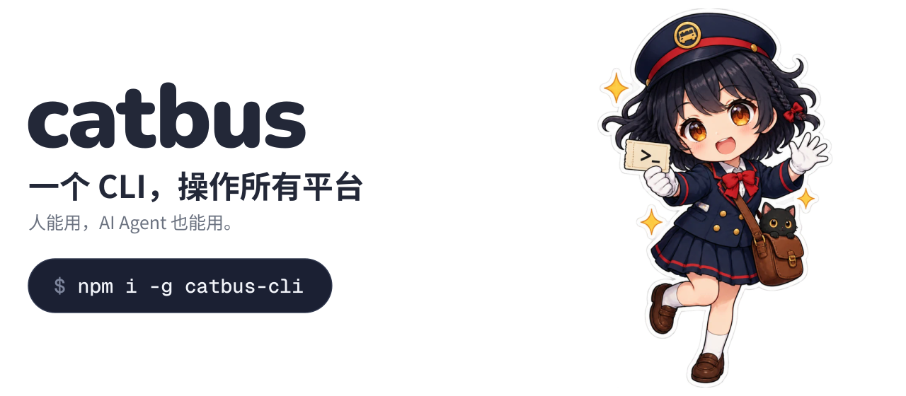
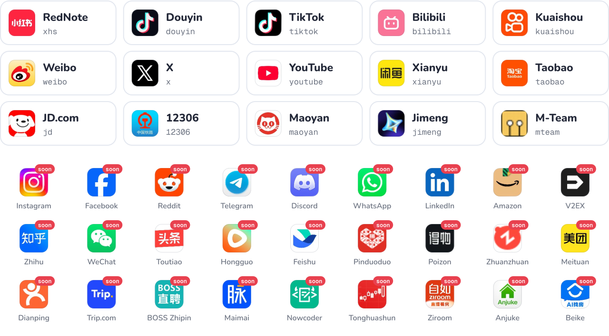

<a href="docs/guide/quick-start.md">
  <picture>
    <source media="(prefers-color-scheme: dark)" srcset="assets/hero-zh-CN-dark.svg">
    
  </picture>
</a>

<div align="center">

[](https://github.com/cv-cat/catbus/stargazers)
[](LICENSE)
[](package.json)

[English](README.md) · **简体中文** · [日本語](README.ja.md) · [한국어](README.ko.md)

</div>

catbus 是一个开源命令行工具，用一套命令操作所有平台：小红书、抖音、TikTok、B 站、X、YouTube……搜索、看详情、下载、发布、私信，返回的都是同一种 JSON。你可以自己用，也可以交给 AI Agent。

<div align="center">

<a href="https://api.openai-next.com">
  <picture>
    <source media="(prefers-color-scheme: dark)" srcset="assets/sponsors/vectrust-dark.png">
    
  </picture>
</a>

<sub>赞助：[Vectrust](https://api.openai-next.com) @ OpenDev Org & NextRouter Alliance · [想出现在这里？](mailto:992822653@qq.com)</sub>

</div>

## 快速上手

```bash
npm i -g catbus-cli         # 只需要 Node

catbus bilibili auth login  # 扫码登录
catbus bilibili item search 猫 --limit 20
catbus tui    # 不想记命令？用全屏界面
```

想用 Docker 或源码安装？看[快速上手指南](docs/guide/quick-start.md)；全屏界面见[终端界面](docs/guide/tui.md)。

## 一套命令，所有平台通用

所有命令都是三段：`catbus <平台> <资源> <动作>`。小红书的笔记、B 站的视频、X 的推文、淘宝的商品，在 catbus 里都叫 `item`，所以同一条命令在每个平台上都能用，换平台只改平台名。

```bash
catbus xhs item search 露营 --limit 20                # 搜索
catbus bilibili item get BV1xx411c7mD                 # 看详情
catbus douyin comment list <item> --all -o jsonl      # 导出全部评论
catbus youtube item download <item> --dir ./videos    # 下载
catbus x item publish --text "hello" --image cat.png  # 发布
catbus bilibili live listen <room> --duration 10m     # 听直播弹幕
catbus taobao msg send "在吗" --item <url>            # 联系卖家
catbus 12306 ticket search 北京 上海                  # 查火车票
```

每条命令返回的 JSON 结构都一样（这里做了精简）：

```json
{
  "ok": true,
  "platform": "bilibili",
  "resource": "item",
  "action": "search",
  "data": [
    {
      "id": "BV1xx411c7mD",
      "kind": "video",
      "url": "https://www.bilibili.com/video/BV1xx411c7mD",
      "title": "…",
      "author": { "id": "…", "name": "…", "url": "…" },
      "stats": { "views": 12000, "likes": 340, "comments": 56, "collects": 78, "shares": 9 }
    }
  ],
  "page": { "cursor": "…", "has_more": true },
  "error": null
}
```

## 平台

<picture>
  <source media="(prefers-color-scheme: dark)" srcset="assets/platforms-dark.svg">
  
</picture>

标着 `soon` 的在路上，目标是所有平台。没有你要的？[提 issue](https://github.com/cv-cat/catbus/issues) 或者[自己加](.github/CONTRIBUTING.md)，一个平台就是一个目录。每个平台支持什么，见[能力矩阵](docs/capabilities.md)。

## 为什么是 catbus

- **不开浏览器，不要 Python。** catbus 像网页一样算签名，直接发 HTTP。只需要 Node，Windows、macOS、Linux 都能用。两个例外：[YouTube 发布](docs/platforms/youtube.md)需要本机的 Chromium，[即梦](docs/platforms/jimeng.md)封装官方 CLI，只支持 macOS。
- **为 Agent 而生。** stdout 只有 JSON，日志走 stderr，退出码稳定，报错里直接给出下一步该执行的命令。
- **登录态是你的。** 存在 `~/.catbus/`，按平台和账号隔离，没有遥测。

## 给 AI Agent 用

_ 车票" width="150" align="right">

```bash
npx skills add cv-cat/catbus
```

把 catbus 技能装进 Claude Code、Cursor、Codex 等。另见 [llms.txt](llms.txt) 和 [AGENTS.md](AGENTS.md)。

然后直接说：

> 找出小红书这周点赞最多的 20 篇露营笔记，列出大家提到最多的装备。

<br clear="right">

## 文档

[快速上手](docs/guide/quick-start.md) · [登录](docs/guide/login.md) · [输出与错误](docs/guide/output.md) · [配置](docs/guide/configuration.md) · [Docker](docs/guide/docker.md) · [各平台说明](docs/platforms/README.md) · [示例](docs/examples/README.md) · [常见问题](docs/guide/faq.md)

## 参与贡献


欢迎新平台、新命令和修复。开始之前读一下 [CONTRIBUTING.md](.github/CONTRIBUTING.md) 和 [AGENTS.md](AGENTS.md)。安全问题见 [SECURITY.md](.github/SECURITY.md)。

<br clear="right">

## Star 趋势

<a href="https://cvcat.site/star-history/svg?repos=cv-cat/catbus&type=Date">
  <picture>
    <source media="(prefers-color-scheme: dark)" srcset="https://cvcat.site/star-history/svg?repos=cv-cat/catbus&type=Date&theme=dark" />
    <source media="(prefers-color-scheme: light)" srcset="https://cvcat.site/star-history/svg?repos=cv-cat/catbus&type=Date" />
    
  </picture>
</a>

<details>
<summary>免责声明</summary>

<br>

- 本项目仅供学习和研究使用，请勿用于商业或违法用途。
- 请遵守各平台的用户协议和你所在地的法律法规；不要采集、传播他人隐私，不要给平台造成过大的请求压力。
- 自动化操作可能触发风控：验证码、限流乃至封号。一切后果由使用者自行承担。
- 本项目与文中提到的任何平台都没有关联，也未获其授权或认可。名称、图标和商标归其所有者所有。

</details>

## 许可证

[MIT](LICENSE) © 2026 [cv-cat](https://github.com/cv-cat)。平台名称和图标归各自所有者所有（[来源](scripts/assets/logos/SOURCES.txt)）。
